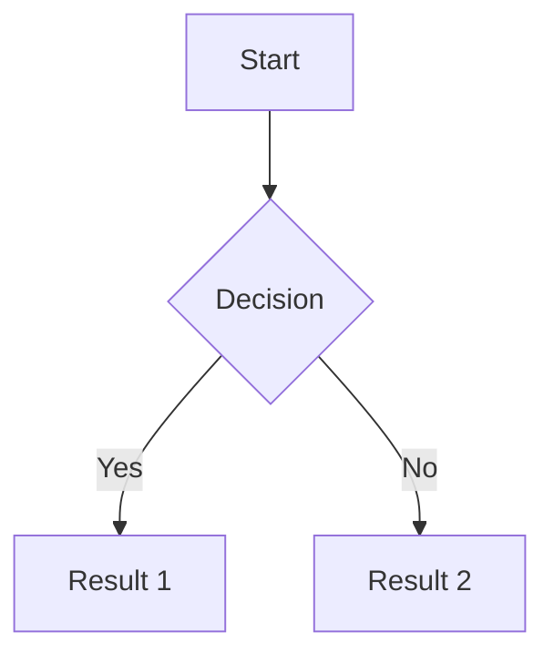

# Mermaid Test



# GeoJSON Test

```geojson
{
  "type": "FeatureCollection",
  "features": [
    {
      "type": "Feature",
      "properties": {
        "name": "Test Location",
        "description": ""
      },
      "geometry": {
        "type": "Point",
        "coordinates": [-73.9857, 40.7484]
      }
    }
  ]
}
```
