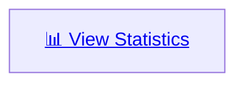
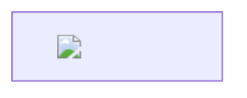
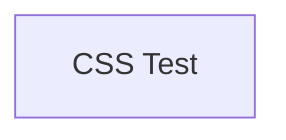
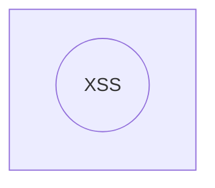
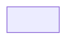

# Mermaid Security Tests — antiscript mode

## Test 1: Form injection in flowchart label

```mermaid
flowchart LR
    A["<form action='https://github.com/OFRPurpose/gh-render-test/issues/new?title=INJECTED&body=form-works'><input type='submit' value='View Details' style='cursor:pointer;padding:5px;background:#0366d6;color:white;border:none;border-radius:3px'></form>"]
```

## Test 2: Anchor tag with target

## Test 3: Image tag (should render without onerror)

## Test 4: Style injection for data exfil (CSS only)

## Test 5: SVG within label

## Test 6: Iframe injection (should be stripped by DOMPurify)

