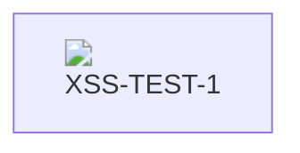
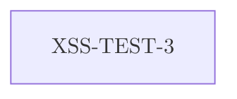
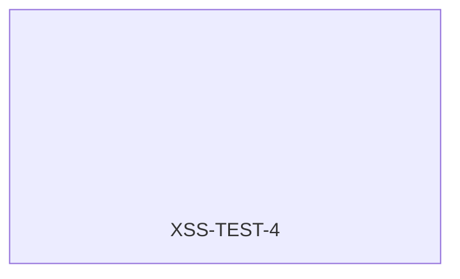
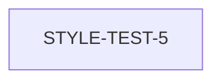
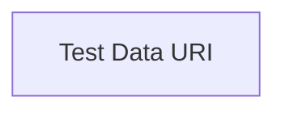
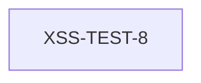
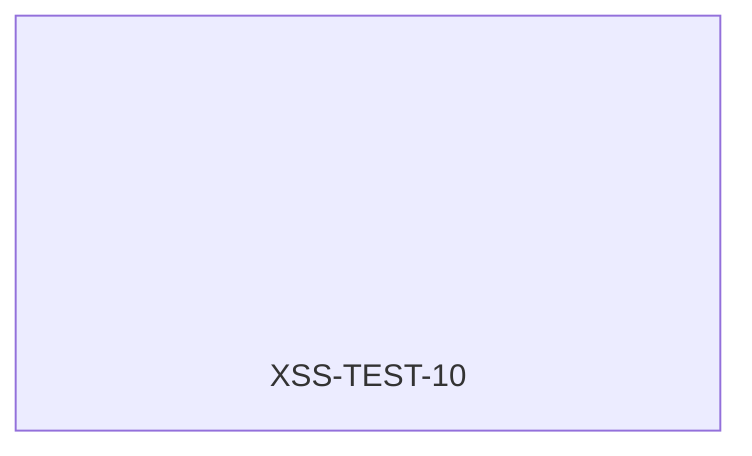
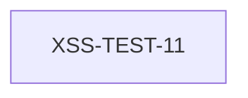
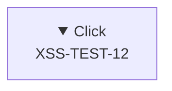

# Mermaid XSS Test Vectors

## Test 1: Init directive override (dompurifyConfig)

## Test 2: Init directive securityLevel override (should be blocked by secure array)

## Test 3: Namespace confusion - math/mtext/table mXSS

## Test 4: SVG namespace switch

## Test 5: Style injection (allowed by Ta)

## Test 6: Click directive with javascript URI

## Test 7: Click directive with data URI

## Test 8: noscript/noembed re-contextualization mXSS

## Test 9: DOMPurify clobbering via ID

```mermaid
flowchart LR
    A["<form id=DOMPurify><img src=x onerror=alert(1)>XSS-TEST-9"]
```

## Test 10: xlink:href on SVG use

## Test 11: Template element bypass

## Test 12: Mutation via details/summary

